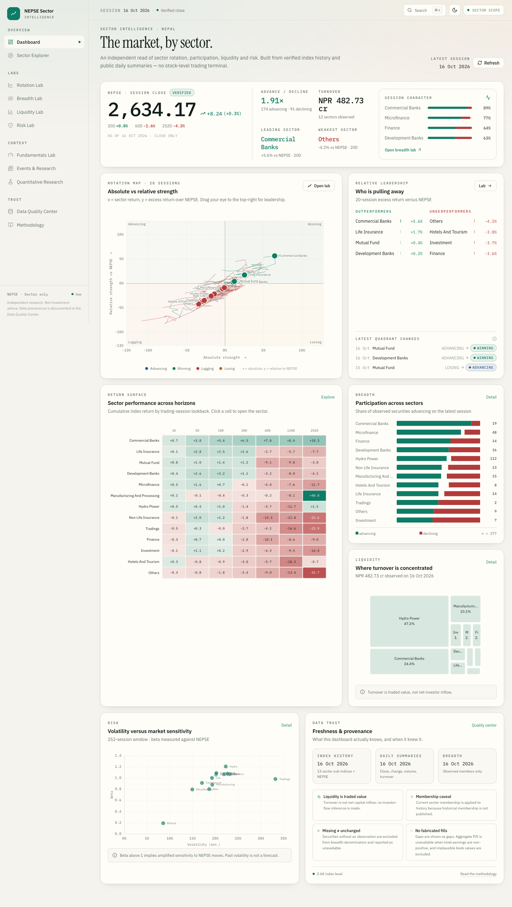

# NEPSE Sector Intelligence

An independent, visualization-first quantitative analysis of **Nepal Stock Exchange sector behaviour**.
It answers questions about rotation, breadth, liquidity, risk and reported fundamentals — at the
sector level — and shows its evidence for every number.

> **Scope:** sectors, not stocks. There is no trading terminal, no price-picking screen, no candlestick
> charting and no OHLC warehouse. Minimal per-company daily summaries are stored only to compute sector
> breadth, liquidity, concentration and capitalisation.



---

## What is here

| Page | Question it answers |
| --- | --- |
| **Dashboard** | What is the market doing by sector, right now? |
| **Sector Explorer** | Everything the app knows about one sector, with the gaps labelled. |
| **Rotation Lab** | Which sectors are winning, advancing, losing or lagging on two axes? |
| **Breadth Lab** | Is the move broad or narrow, and is participation improving? |
| **Liquidity Lab** | Where is trading value concentrated, and how concentrated is it inside a sector? |
| **Risk Lab** | What shape is the path — volatility, beta, drawdown, historical VaR? |
| **Fundamentals Lab** | What do the latest verified filings say in aggregate, and what is missing? |
| **Events & Research** | Corporate events: an explicit coverage gap, not an invented calendar. |
| **Quantitative Research Lab** | Factor scores, quadrant persistence and an illustrative rotation backtest. |
| **Data Quality Center** | Coverage, freshness, ingestion receipts and open gaps. |
| **Methodology** | Formulas, axis contracts and the status vocabulary. |

All eleven pages are implemented and were exercised end-to-end in a real browser; screenshots in
`docs/screenshots/` are captures of the running application, not mockups.

---

## Architecture

```
frontend/   React 18 + TypeScript + Vite + Tailwind + Apache ECharts
   │  typed fetch client, React Query, hash-free SPA routing
   ▼
backend/    FastAPI + SQLAlchemy 2 + pandas/numpy/scipy
   │  analytics services → calculations package
   ▼
SQLite (default)  or  PostgreSQL (DATABASE_URL)
```

The application is **fully independent**. It does not import, call or share infrastructure with any
other trading application. No private files, databases, environment variables or analytics engines were
copied in.

* **One service in production.** The FastAPI app serves `/api/*` and, when `frontend/dist` exists, the
  built SPA (including a catch-all route for client-side navigation).
* **Read-only API.** Every endpoint is `GET`; ingestion is a separate CLI process.
* **Deterministic calculations.** All maths lives in `backend/app/calculations/` and is unit-tested
  independently of HTTP.
* **Honest serialisation.** Non-finite floats are converted to `null` by a response class, so the API can
  never emit invalid JSON (`NaN`, `Infinity`).
* **Cheap to run.** A 90 s in-process cache and gzip keep warm payloads at 1–11 ms and the dashboard at
  about 10 kB on the wire; no Redis, no worker, no separate frontend host.

### Layout

```
backend/app/
  api/            routes + JSON sanitiser
  calculations/   rotation, breadth, risk, liquidity, concentration, fundamentals, factors
  ingestion/      verified source URLs, HTTP cache, pipeline
  services/       analytics payload builders + short TTL cache
  models.py       sectors, index observations, securities, memberships, daily summaries, filings
backend/tests/    58 tests (unit + API contract + serialiser)
frontend/src/
  pages/          11 pages + 404
  components/     Chart, RotationQuadrant, SectorHeatmap, Layout, UI primitives
  lib/            API client and types, formatters, chart theme, navigation, theme store
docs/             project documentation and real screenshots
scripts/ingest.py ingestion CLI
Dockerfile        single-image build (frontend build + Python runtime)
```

---

## Quick start

Requirements: Python ≥ 3.11, Node ≥ 18.

```bash
# 1. Backend
cd backend
python3 -m venv .venv
.venv/bin/pip install -e ".[dev]"
.venv/bin/uvicorn app.main:app --reload --port 8000

# 2. Frontend (second terminal)
cd frontend
npm install
npm run dev            # http://127.0.0.1:5173, proxies /api → :8000
```

The API is empty until the ingestion CLI has run:

```bash
cd ..                  # repository root
backend/.venv/bin/python scripts/ingest.py all
```

Sub-commands: `sectors`, `indices`, `securities`, `summaries`, `fundamentals`, `all`, `init`.
`--no-summaries` skips the slow per-security pass. Ingestion caches raw responses under
`backend/data/raw/` and is idempotent: unique constraints on `(index_code, trade_date)` and
`(symbol, trade_date)`, and the fundamentals snapshot is replaced atomically so amended filings
refresh rather than duplicate.

### Production build

```bash
cd frontend && npm run build     # writes frontend/dist
cd ../backend && .venv/bin/uvicorn app.main:app --host 0.0.0.0 --port 8000
```

The backend serves the built SPA at `/` and the API at `/api/*`.

---

## Data

| Dataset | Source | Status |
| --- | --- | --- |
| NEPSE index + 13 sub-indices, 1997→2026 | `menaceXnadin/nepse-historical-market-data-csv` (public CSV mirror) | VERIFIED |
| Sector metadata, current membership, market-cap snapshot | YONEPSE static JSON | VERIFIED / PROVISIONAL |
| Minimal security daily summaries (close, change, volume, turnover) | `binayabaral/nepal-market-data` (MIT) | VERIFIED |
| Reported EPS / P/E / paid-up capital / profit / net worth | YONEPSE `financials.json` | PROVISIONAL |

Current warehouse: **13 sectors**, **41,509 index observations** (34,896 sector + 6,613 NEPSE),
**433,817 daily summaries** across **285 symbols**, **467 securities** (**331 classified**),
**4,840 fundamental reports** across **307 symbols**. Latest index date: **2026-10-16**.

The official NEPSE API requires authentication and returned HTTP 401 during the audit. It was not
bypassed. Consequences and every other gap are listed in [KNOWN_LIMITATIONS.md](docs/KNOWN_LIMITATIONS.md)
and surfaced inside the app.

> Historical sector membership is not published by the available sources. Current membership is applied
> to history and the app says so wherever breadth is derived.

---

## Rotation Lab contract

The quadrants are fixed and tested:

| Quadrant | Absolute strength (x) | Relative strength (y) |
| --- | --- | --- |
| **Winning** (top-right) | `x > 0` | `y > 0` |
| **Advancing** (top-left) | `x ≤ 0` | `y > 0` |
| **Losing** (bottom-right) | `x > 0` | `y ≤ 0` |
| **Lagging** (bottom-left) | `x ≤ 0` | `y ≤ 0` |

Lookbacks: 5, 10, 20, 60, 120 sessions; default 20. Thresholds are configurable and default to zero.

---

## Tests and checks

```bash
cd backend  && .venv/bin/python -m pytest -q        # 58 passed
cd backend  && .venv/bin/ruff check app tests       # clean
cd frontend && npx tsc -b                          # type-check
cd frontend && npm run build                       # production build
```

The browser pass is documented in [TESTING_REPORT.md](docs/TESTING_REPORT.md): all 12 routes rendered
with **zero console errors**, and interactions (lookback changes, theme toggle, command palette,
sector switches) were exercised against the running build.

---

## Documentation

* [PROJECT_PLAN.md](docs/PROJECT_PLAN.md) — scope, priorities, decisions, milestones
* [DATA_SOURCE_AUDIT.md](docs/DATA_SOURCE_AUDIT.md) — what each source provides, licensing, failures
* [DATA_DICTIONARY.md](docs/DATA_DICTIONARY.md) — tables, fields, units, keys
* [ANALYTICS_METHODOLOGY.md](docs/ANALYTICS_METHODOLOGY.md) — every formula and its caveats
* [VISUALIZATION_CATALOG.md](docs/VISUALIZATION_CATALOG.md) — every chart, its encoding and purpose
* [TESTING_REPORT.md](docs/TESTING_REPORT.md) — automated and browser evidence
* [DEPLOYMENT.md](docs/DEPLOYMENT.md) — Docker, free-tier hosting options, database strategy
* [KNOWN_LIMITATIONS.md](docs/KNOWN_LIMITATIONS.md) — gaps, refused shortcuts, data-quality notes
* [IMPLEMENTATION_STATUS.md](docs/IMPLEMENTATION_STATUS.md) — status of every surface

---

## Status vocabulary

`IMPLEMENTED` · `TESTED-PASS` · `TESTED-FAIL` · `NOT-TESTED` · `BLOCKED`

No feature is labelled `TESTED-PASS` unless it was actually run. Events are `BLOCKED` because no
verified feed exists; the page discloses that instead of fabricating a calendar.

---

## Disclaimer

Independent research and education only. Not investment advice, a recommendation, or a forecast.
Past volatility and drawdowns are descriptive, not predictive.

The source data remains subject to the terms of its publishers; see the data-source audit before
redistributing any ingested dataset. No licence file has been added to this repository — choose one
before publishing it.
