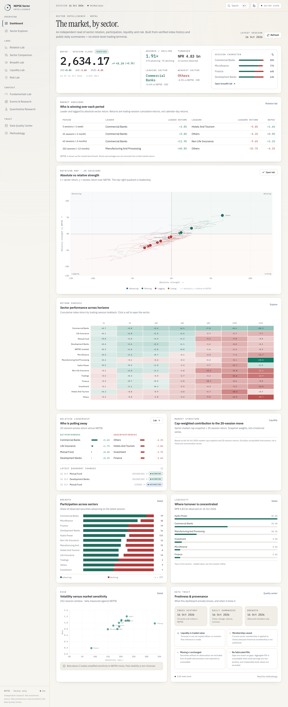
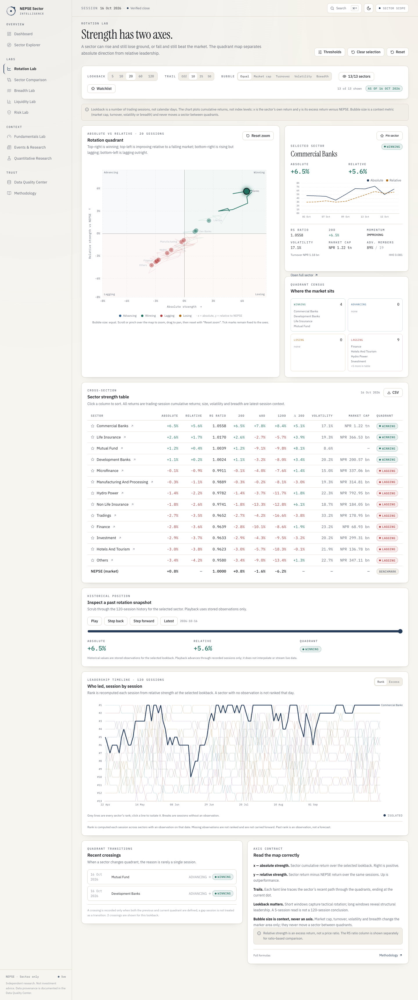
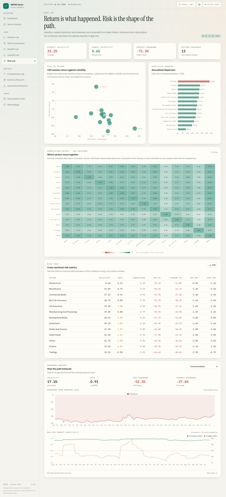
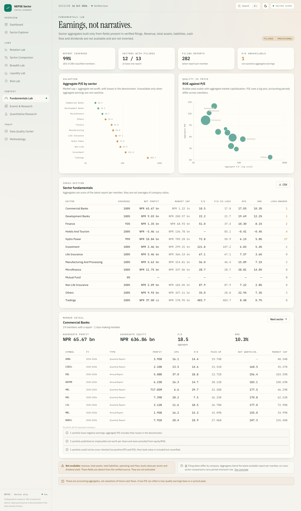
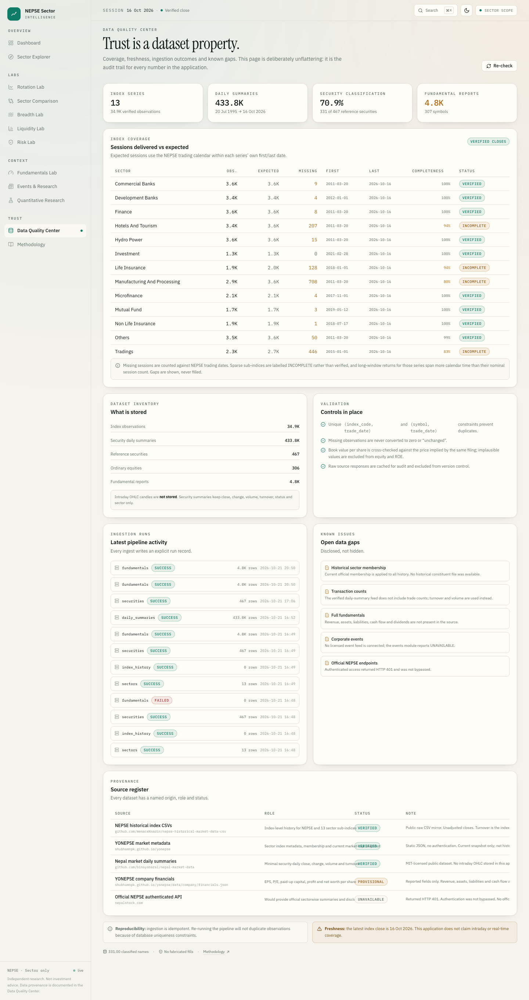

# NEPSE Sector Intelligence

An independent, visualization-first quantitative analysis of **Nepal Stock Exchange sector behaviour**.
It answers questions about rotation, breadth, liquidity, risk and reported fundamentals — at the
sector level — and shows its evidence for every number.

> **Scope:** sectors, not stocks. There is no trading terminal, no price-picking screen, no candlestick
> charting and no OHLC warehouse. Minimal per-company daily summaries are stored only to compute sector
> breadth, liquidity, concentration and capitalisation.



---

## Live deployment

| Component | Where |
| --- | --- |
| **App** | https://sector-overview-web.vercel.app |
| **API health** | https://sector-overview.vercel.app/api/health |
| **Frontend** | Vercel project `sector-overview-web` (Vite, root `frontend`) |
| **Backend** | Vercel project `sector-overview` (FastAPI, root `backend`) |
| **Database** | Neon PostgreSQL |
| **Daily refresh** | GitHub Actions, `09:45 UTC` = **3:30 PM Nepal time** |

The Vercel projects are connected to `KARIK-x/sector-overview` on `main`, so pushes deploy
automatically. The daily ingestion workflow writes directly to Neon; no Vercel redeploy is needed
for a data refresh.

---

## What is here

| Page | Question it answers |
| --- | --- |
| **Dashboard** | What is the market doing by sector, right now? |
| **New** | Every sector and NEPSE on one own-start percentage-change scale. |
| **Sector Explorer** | Everything the app knows about one sector, with the gaps labelled. |
| **Rotation Lab** | Which sectors are winning, advancing, losing or lagging on two axes? |
| **Sector Comparison** | How have selected sectors and NEPSE travelled over the same window? |
| **Breadth Lab** | Is the move broad or narrow, and is participation improving? |
| **Liquidity Lab** | Where is trading value concentrated, and how concentrated is it inside sectors? |
| **Risk Lab** | Which sectors are volatile, correlated or deep in drawdown? |
| **Fundamentals Lab** | What do the latest verified filings imply, and what is missing? |
| **Quantitative Research Lab** | What do a transparent factor score, transition matrix and illustrative backtest say? |
| **Data Quality Center** | What is stored, how complete is it, and where did it come from? |
| **Events & Research** | What would a corporate-events feed require, and why is it unavailable? |
| **Methodology** | What is every formula, window and status label? |
| **Account → Private Ledger** | What did I trade, what does it cost, what cash is committed, and what do I hold? |

Thirteen public content pages, the private six-tab Account section, and a 404 route. All charts are
Apache ECharts; all market numbers come from the FastAPI backend, never from hard-coded UI values.
Charts share pan, zoom, period, reset, full-screen and PNG controls; CSV and PNG exports are
client-side. Account data is separate: it is user-owned, server-side, key-protected and never cached
by the public CDN.

---

## Architecture

```
Browser
   │  React 18 + TypeScript + Vite + Tailwind, React Query, ECharts
   ▼
Vercel CDN ── frontend project (`sector-overview-web`)
   │  cross-origin calls to VITE_API_URL
   ▼
Vercel Function ── FastAPI backend (`sector-overview`)
   │  read-only JSON under /api/*, gzip, short TTL cache
   ▼
SQLAlchemy 2 ── Neon PostgreSQL (DATABASE_URL)
   ▲
   │  daily batch
GitHub Actions ── `scripts/ingest.py all` at 09:45 UTC
```

The application is **fully independent**. It does not import, call or share infrastructure with any
other trading application. No private files, databases, environment variables or analytics engines were
copied in.

* **Two Vercel projects in production.** The Vite SPA is served by `sector-overview-web`; FastAPI is
  served by `sector-overview` and is reachable at `/api/*`. Locally and in the Docker image, one
  FastAPI process can still serve both.
* **Read-only public API.** Market endpoints are `GET`; ingestion is a separate CLI process. The
  private Account endpoints under `/api/account/*` support authenticated writes, but are isolated
  from the market cache and require a per-vault bearer key.
* **Deterministic calculations.** Maths lives in `backend/app/calculations/` and
  `backend/app/account/`, unit-tested independently of HTTP and the database.
* **Honest serialisation.** Non-finite floats become `null`; the API cannot emit `NaN`/`Infinity`.
* **Cheap to run.** Gzip and a short TTL cache keep payloads small; Neon stores the warehouse and
  GitHub Actions performs the daily batch. No Redis, worker or always-on server is required.

### Layout

```
backend/app/
  api/            routes + JSON sanitiser
  calculations/   rotation, breadth, risk, liquidity, concentration, fundamentals, factors
  ingestion/      verified source URLs, HTTP cache, pipeline
  services/       analytics payload builders + short TTL cache
  account/        private ledger: auth, parser, fees, WACC, cash flow, imports, routes
  models.py       sectors, index observations, securities, memberships, daily summaries, filings
backend/tests/    124 tests (unit + API contract + serialiser + account ledger)
frontend/src/
  pages/          13 public pages + 6 account tabs + 404
  pages/account/  vault gate, overview, transactions, cash flow, holdings, SMS import, settings
  components/     Chart, RotationQuadrant, SectorHeatmap, RankTimeline, Layout, UI primitives
  lib/            API client/types, formatters, chart theme, navigation, theme store, exports
docs/             project, data, methodology, testing, status, visual/functional audits
scripts/          ingestion CLI + Playwright verification harnesses
.github/workflows/daily-ingest.yml  cloud refresh at 09:45 UTC
frontend/vercel.json               SPA fallback for client-side routes
artifacts/screenshots/  16 final evidence images
Dockerfile        single-image build (frontend build + Python runtime)
```

---

## Quick start

Requirements: Python ≥ 3.11, Node ≥ 18.

```bash
# 1. Backend
cd backend
python3 -m venv .venv
.venv/bin/pip install -e ".[dev]"
.venv/bin/uvicorn app.main:app --reload --port 8000

# 2. Frontend (second terminal)
cd frontend
npm install
npm run dev            # http://127.0.0.1:5173, proxies /api → :8000
```

The API is empty until the ingestion CLI has run:

```bash
cd ..                  # repository root
backend/.venv/bin/python scripts/ingest.py all
```

Sub-commands: `sectors`, `indices`, `securities`, `summaries`, `fundamentals`, `all`, `init`.
`--no-summaries` skips the slow per-security pass. Ingestion caches raw responses under
`backend/data/raw/` and is idempotent: unique constraints on `(index_code, trade_date)` and
`(symbol, trade_date)`, and the fundamentals snapshot is replaced atomically so amended filings refresh
rather than duplicate.

### Production build

```bash
cd frontend && npm run build     # writes frontend/dist
cd ../backend && .venv/bin/uvicorn app.main:app --host 127.0.0.1 --port 8000
```

The backend serves the built SPA at `/` and the API at `/api/*`. This single-service mode is used by
the Docker image and local production runs. The public deployment uses the two Vercel projects
described above; see [`docs/DEPLOYMENT.md`](docs/DEPLOYMENT.md) for the exact topology.

---

## Private Account Ledger

The sidebar **Account** group is a separate, opt-in ledger for broker SMS. It parses BUY/SELL
messages (including multi-stock bills and decimals), previews every row before import, and commits
to a server-side vault protected by a one-time 256-bit key. The ledger calculates versioned Nepal
brokerage, SEBON, DP and capital-gains charges, reconciles against the broker's `BAmt`, and models
T+1 payment/EDIS obligations separately from T+2 CDSC settlement.

It then answers the cash question: opening balances across multiple banks, actual deposits,
withdrawals and transfers, partial payments/receipts, projected obligations, daily shortfalls, and
a projected close that never pretends expected sale proceeds are already cash. Holdings use WACC
with FIFO holding-period splits, realised/unrealised P&L and explicit manual-price overrides.

* The full schema, formulas, fee sources, status vocabulary, security model, limitations and test
  evidence are in **[ACCOUNT_LEDGER.md](docs/ACCOUNT_LEDGER.md)**.
* Synthetic screenshots are in [`docs/account-screenshots/`](docs/account-screenshots/).
* The vault key lives in `sessionStorage` for the current tab by default; only the explicit
  “Remember this key on this device” option writes it to `localStorage`. Transactions, balances
  and holdings are **never** stored in browser storage.

This feature is implemented and locally tested, but is not yet committed, pushed or deployed.

---

## Data

| Dataset | Source | Status |
| --- | --- | --- |
| NEPSE index + 13 sub-indices, 1997→2026 | `menaceXnadin/nepse-historical-market-data-csv` (public CSV mirror) | VERIFIED / INCOMPLETE per series |
| Sector metadata, current membership, market-cap snapshot | YONEPSE static JSON | VERIFIED / PROVISIONAL |
| Minimal security daily summaries (close, change, volume, turnover) | `binayabaral/nepal-market-data` (MIT) | VERIFIED |
| Reported EPS / P/E / paid-up capital / profit / net worth | YONEPSE `financials.json` | PROVISIONAL |
| Corporate events | — | `UNAVAILABLE`; not fabricated |

Current warehouse: **13 sectors**, **41,509 index observations** (34,896 sector + 6,613 NEPSE),
**433,817 daily summaries** across **285 symbols**, **467 securities** (**331 classified**, 343 with a
market-cap snapshot), **4,840 fundamental reports** across **307 symbols**. Latest index date:
**2026-10-16**.

The official NEPSE API requires authentication and returned HTTP 401 during the audit. It was not
bypassed. Consequences and every other gap are in [KNOWN_LIMITATIONS.md](docs/KNOWN_LIMITATIONS.md) and
surfaced inside the app.

> Historical sector membership is not published by the available sources. Current membership is applied
> to history and the app says so wherever breadth is derived.

---

## Rotation Lab contract

The quadrants are fixed and tested:

| Quadrant | Absolute strength (x) | Relative strength (y) |
| --- | --- | --- |
| **Winning** (top-right) | `x > 0` | `y > 0` |
| **Advancing** (top-left) | `x ≤ 0` | `y > 0` |
| **Losing** (bottom-right) | `x > 0` | `y ≤ 0` |
| **Lagging** (bottom-left) | `x ≤ 0` | `y ≤ 0` |

Lookbacks: 5, 10, 20, 60, 120 sessions; default 20. Thresholds are configurable and default to zero.
Bubble size can encode market cap, turnover, volatility or breadth, but never moves a sector between
quadrants. Trails are true replays of the metric, not interpolations.

Worked example, 2026-10-16: Commercial Banks returned **+6.4629 %** over 20 sessions; NEPSE returned
**+0.8326 %**; relative strength **+5.6304 %**; RS ratio **1.0558** → **Winning**. Census: 4 Winning,
0 Advancing, 0 Losing, 9 Lagging.

---

## Tests and checks

```bash
cd backend  && .venv/bin/python -m pytest -p no:warnings   # 124 passed
cd backend  && .venv/bin/ruff check app tests              # clean
cd frontend && npx tsc -p tsconfig.app.json --noEmit       # type-check
cd frontend && npm run build                               # production build
```

Browser evidence (Playwright, production build):

* **Firefox:** 55 primary + 15 supplemental + 6 extras = **76 checks**, all pass, zero console errors.
* **Chrome:** **36 checks**, all pass, zero console errors.
* Real CSV/PNG downloads inspected: non-empty files, expected headers, PNG magic bytes and dimensions.
* **WebKit/Safari:** `BLOCKED` — Playwright's WebKit build crashes on this host.
* 16 final market screenshots in [`artifacts/screenshots/`](artifacts/screenshots/), captured in
  Firefox with pre-sized viewports (no stitched full-page captures); dimensions and method are in
  the [screenshot index](artifacts/screenshots/README.md).
* Account browser validation used synthetic data only: locked gate, unlock/remember, vault
  creation, one-time key, rotation (old key rejected, new key accepted), audited correction and
  revert, partial settlement and reversal, cash movement and paired-transfer reversal, manual
  price, bank-account create/deactivate, SMS preview, commit and duplicate skip. Ten screenshots are in
  [`docs/account-screenshots/`](docs/account-screenshots/).

Details and limitations: [TESTING_REPORT.md](docs/TESTING_REPORT.md). The committed harnesses live in
[`scripts/verification/`](scripts/verification/).

---

## Documentation

* [PROJECT_PLAN.md](docs/PROJECT_PLAN.md) — scope, priorities, decisions, milestones
* [DATA_SOURCE_AUDIT.md](docs/DATA_SOURCE_AUDIT.md) — what each source provides, licensing, failures
* [DATA_DICTIONARY.md](docs/DATA_DICTIONARY.md) — tables, fields, units, keys, API
* [ACCOUNT_LEDGER.md](docs/ACCOUNT_LEDGER.md) — private ledger schema, fees, taxes, cash flow, security, limitations
* [ANALYTICS_METHODOLOGY.md](docs/ANALYTICS_METHODOLOGY.md) — every formula and its caveats
* [VISUALIZATION_CATALOG.md](docs/VISUALIZATION_CATALOG.md) — all 27 chart surfaces and encodings
* [VISUALIZATION_AUDIT.md](docs/VISUALIZATION_AUDIT.md) — page-by-page visual review and fixes
* [FUNCTIONALITY_AUDIT.md](docs/FUNCTIONALITY_AUDIT.md) — requirement-by-requirement trace
* [TESTING_REPORT.md](docs/TESTING_REPORT.md) — automated, browser, export and screenshot evidence
* [DEPLOYMENT.md](docs/DEPLOYMENT.md) — Docker, free-tier hosting options, database strategy
* [KNOWN_LIMITATIONS.md](docs/KNOWN_LIMITATIONS.md) — gaps, refused shortcuts, data-quality notes
* [IMPLEMENTATION_STATUS.md](docs/IMPLEMENTATION_STATUS.md) — status of every page, endpoint and feature

### Screenshot gallery

| | |
| --- | --- |
|  |  |
|  |  |

---

## Status vocabulary

`IMPLEMENTED` · `TESTED-PASS` · `TESTED-FAIL` · `NOT-TESTED` · `BLOCKED`

No feature is labelled `TESTED-PASS` unless it was actually run. Events are `BLOCKED` because no
verified feed exists; the page discloses that instead of fabricating a calendar. PostgreSQL, Docker,
public deployment, WebKit/Safari, screen-reader testing and load testing are `NOT-TESTED` or `BLOCKED`,
as recorded in the status and testing documents.

The private Account ledger is `IMPLEMENTED` and `TESTED-PASS` locally against synthetic data. It is
**not committed, pushed or deployed**; account deployment, migration history and production
PostgreSQL validation remain pending.

---

## Disclaimer

Independent research and education only. Not investment advice, a recommendation, or a forecast.
Past volatility and drawdowns are descriptive, not predictive.

The source data remains subject to the terms of its publishers; see the data-source audit before
redistributing any ingested dataset. No licence file has been added to this repository — choose one
before publishing it.
